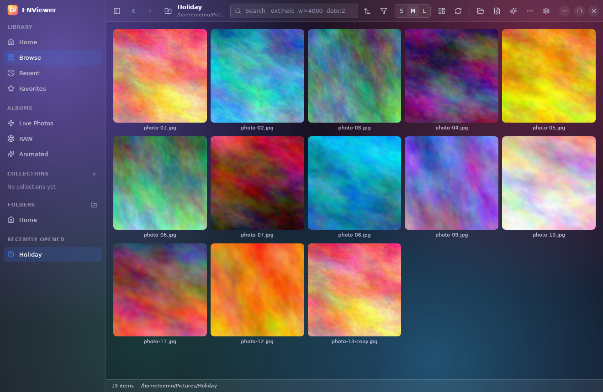
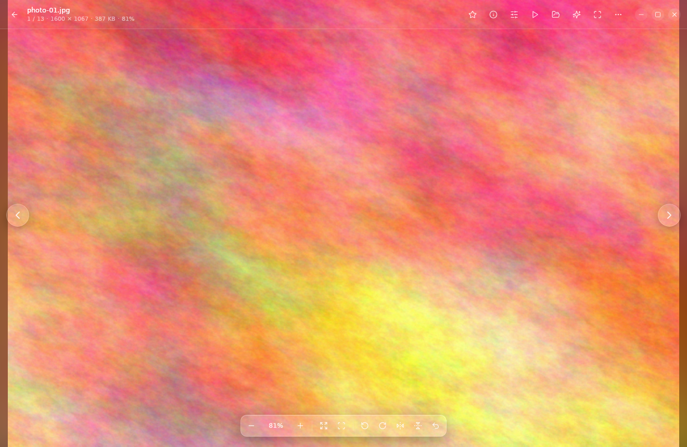
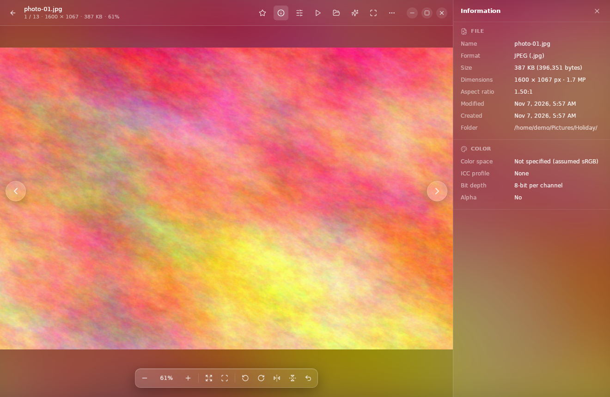
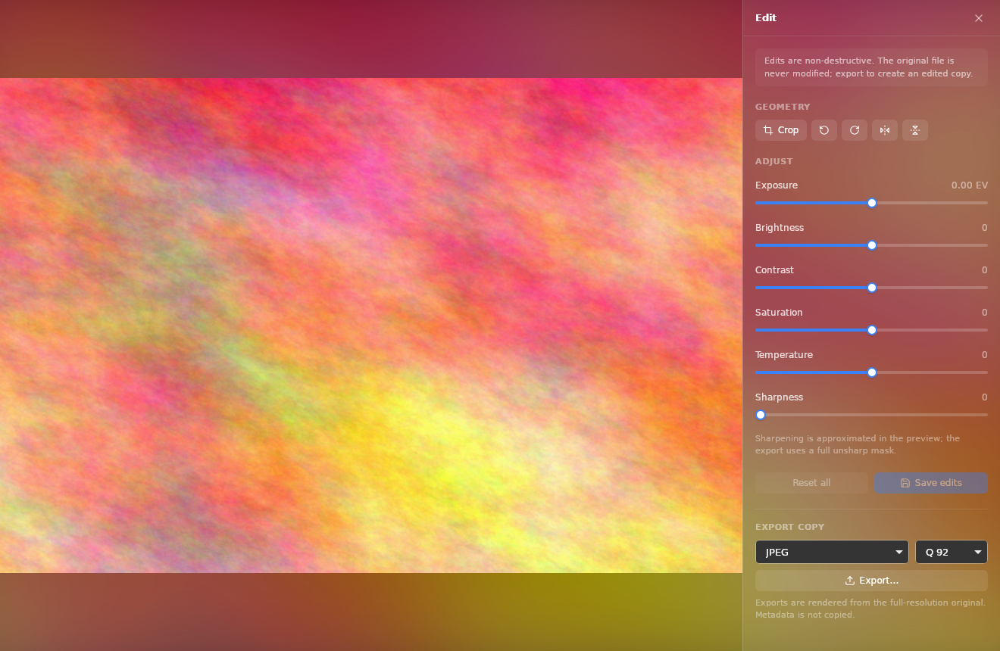
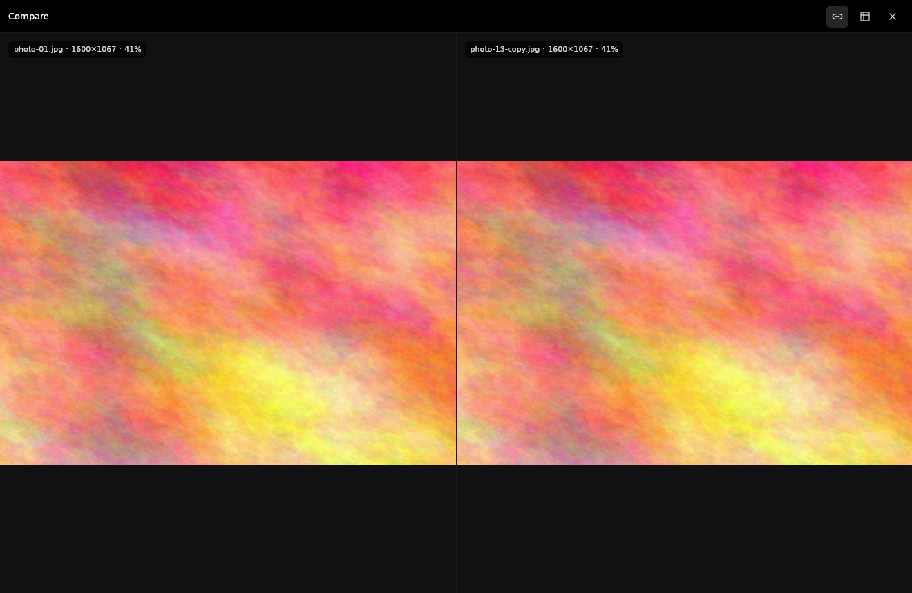
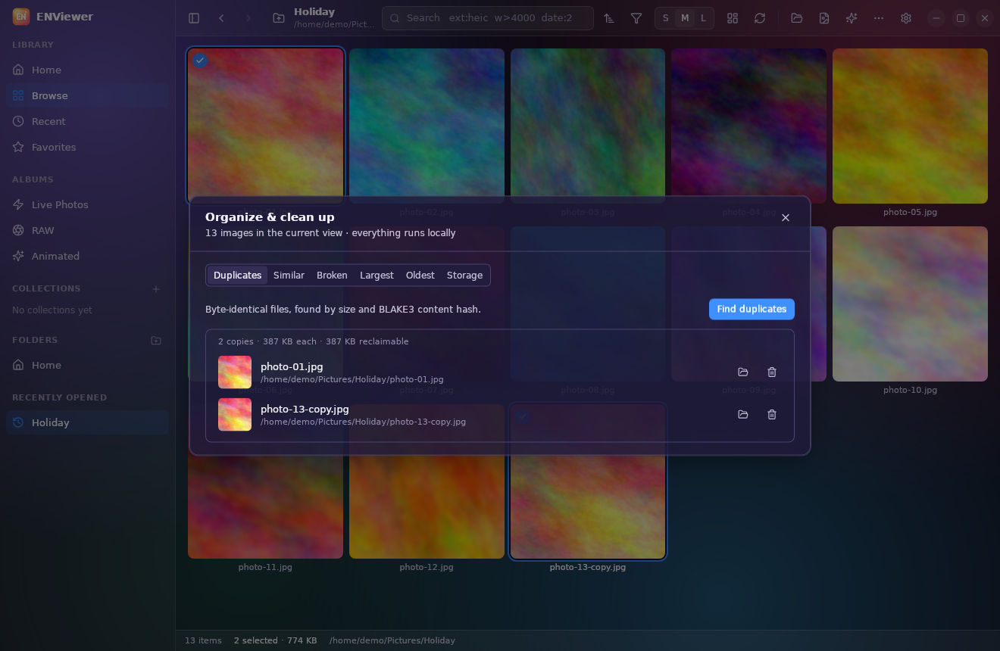
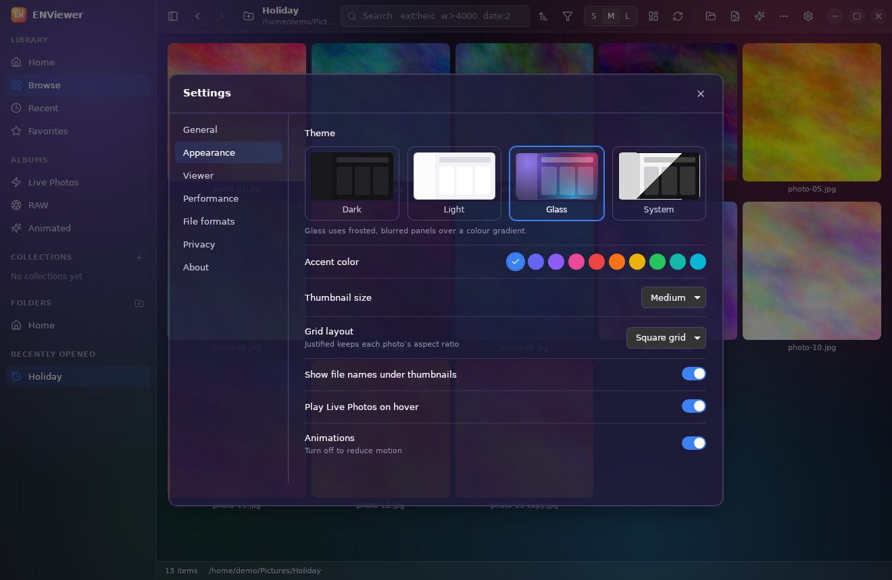

# ENViewer user guide

## Opening photos

* **Open folder** (`Ctrl+O`) or **Open file** (`Ctrl+Shift+O`) from the toolbar,
  or drag a file or folder onto the window.
* Double-click an image in your file manager after choosing ENViewer in
  **Open with…**. If ENViewer is already running, it switches to that image.
* Your Pictures, Downloads and Desktop folders are in the sidebar. Add your own
  with the **+** next to *Folders*; right-click one to remove it.
* Subfolders appear as chips above the grid. `Alt+↑` or `Backspace` goes to the
  parent folder, and `Alt+←` / `Alt+→` (or the mouse side buttons) go back and
  forward.

## Browsing

* **Thumbnail size**: S / M / L in the toolbar. The layout button switches
  between a square grid and a *justified* layout that keeps every photo's aspect ratio.
* **Select**: click, `Ctrl+click` to toggle, `Shift+click` for a range, `Ctrl+A`
  for all. You can also use the round checkbox on each tile.
* **Badges**: `LIVE` marks a Live Photo (hover to play it), ✦ marks an animated
  image, ★ a favourite, and the corner label shows formats like HEIC or a RAW type.
* **Sort** by name, capture date (EXIF), created or modified date, size,
  dimensions or type.
* **Filter** by favourites, Live Photos, RAW, animated, format, orientation,
  minimum resolution and date range. The **Albums** in the sidebar
  are one-click filters for the current folder.
* **Search** (`Ctrl+F`) matches file names and folders. Tokens: `ext:heic`,
  `folder:holiday`, `date:2024-07`, `w>4000`, `h<=1080`.

## The viewer

| Action | Mouse | Keyboard |
|--------|-------|----------|
| Next / previous | side arrows, mouse back/forward buttons, horizontal touchpad swipe | `→` / `←` |
| Zoom at cursor | scroll wheel (up = in) | `+` / `−` |
| Fit / 100 % | double-click toggles | `0` / `1` |
| Pan | drag (left or middle button) | |
| Rotate | toolbar | `R` / `Shift+R` |
| Flip | toolbar | `H` / `V` |
| Reset view | toolbar | `Ctrl+0` |
| Full screen | toolbar | `F` / `F11` |
| Info / Edit | toolbar | `I` / `E` |
| Favourite | ★ | `.` or `L` |
| Live Photo / animation | hover the **LIVE** badge (muted) or click it | `Space` |
| Close | ← in the top-left corner | `Esc` |

The scroll wheel always zooms; it never changes images. Zoom speed, limits,
smooth zoom and the background colour are in **Settings → Viewer**. 100 % means
one image pixel per screen pixel, even on high-DPI displays.

Rotating and flipping in the viewer only change the *view*. Nothing is written to
the file.

## Live Photos

When an iPhone photo (`IMG_1234.HEIC` or `.JPG`) sits next to its motion file
(`IMG_1234.MOV`), ENViewer shows them as one Live Photo. If both files carry
Apple's content identifier, they must match (*verified*). Otherwise ENViewer only
pairs short clips (≤ 6 s) and says "matched by file name" in the Info panel.
Longer videos with the same name are not listed. Open those in ENPlayer.
Copying, moving, renaming or deleting a Live Photo includes its motion file.

## Editing (non-destructive)

Press `E` in the viewer. Crop, rotate, flip, exposure, brightness, contrast,
saturation, temperature and sharpness preview instantly. **Save edits**
stores the settings in ENViewer's database, and the original file is untouched.
**Export…** renders the edits at full resolution into a *new* file (JPEG,
PNG, lossless WebP, TIFF or BMP). The original can never be chosen as the
export target.

## Tools (••• in the toolbar)

* **Slideshow** (`F6`): interval, transitions (fade, slide, slide up, zoom, blur, or **Random**: a different effect on every slide), loop, random
  order. `Space` pauses, `←`/`→` step, `Esc` exits.
* **Compare selected**: select exactly two images. Zoom and pan stay
  synchronised (toggle with the link button), and the table highlights
  differences in dimensions and EXIF.
* **Batch operations**: rename with patterns (`{name}`, `{n:4}`, `{date}`,
  `{captured}`, `{ext}`) with a live preview and conflict check; convert and resize to a
  folder; favourite or unfavourite all; inspect metadata in a table.
* **Organize & clean up**: exact duplicates (content hash), visually similar
  images (perceptual hash, computed locally), broken files, largest and oldest
  images, and storage by format.

## Files

Right-click any image for: open with the default app, show in file manager, copy
image (bitmap) or path, copy to…, move to…, rename (`F2`), add to a collection,
and move to Trash (`Delete`). ENViewer always uses the system Trash, asks first
(configurable), and never overwrites an existing file. It picks `name (2).jpg`
instead.

## Privacy

ENViewer works offline and never uploads anything. **Settings → Privacy** can turn
off history, clear it, and hide GPS coordinates in the Info panel. Thumbnails
are cached on disk (limit and *Clear cache* in **Settings → Performance**).

## Always on top

Click the pin icon next to the window buttons, or go to **Settings → General → Always on top**, to
keep ENViewer above other windows. On Ubuntu with Wayland, restart ENViewer once after turning it on.
